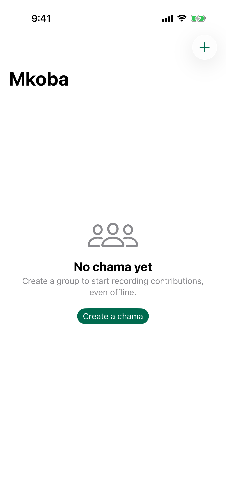
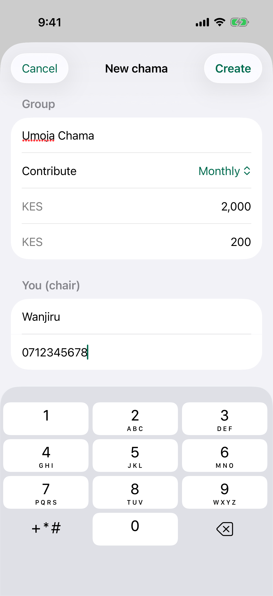
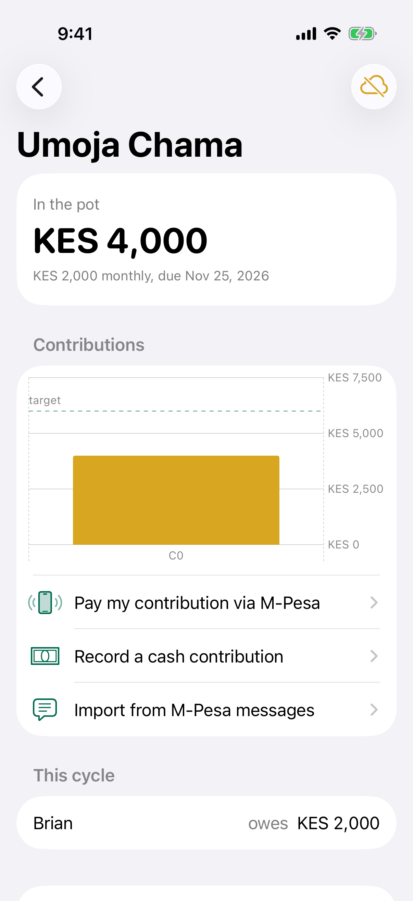
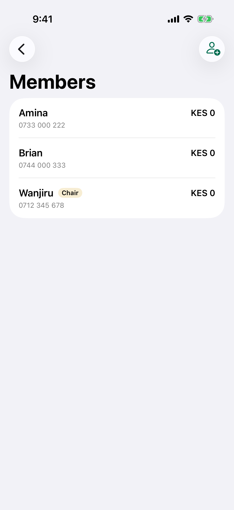
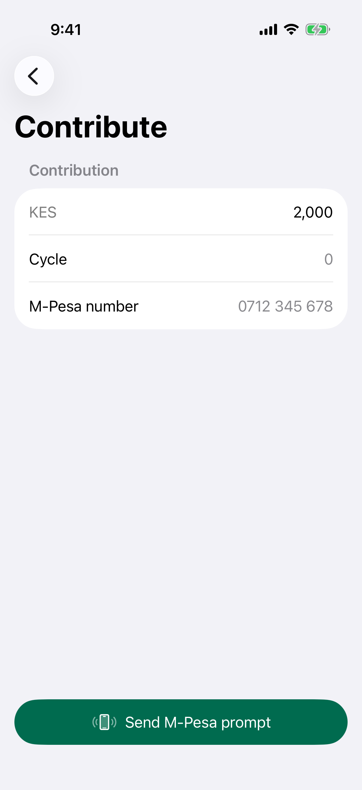
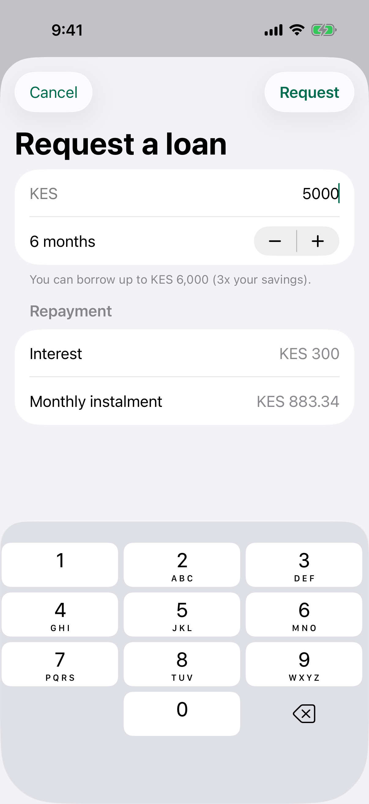
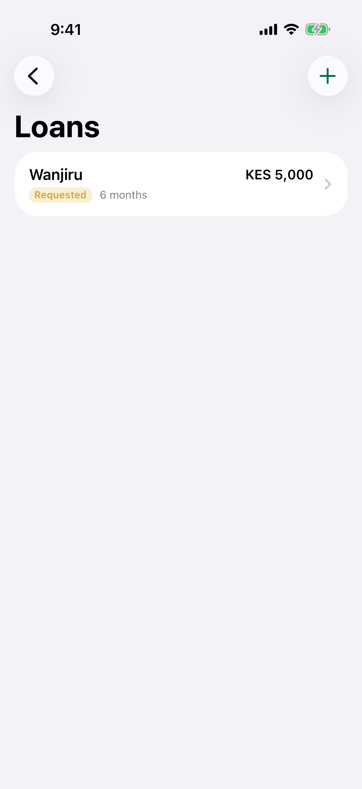
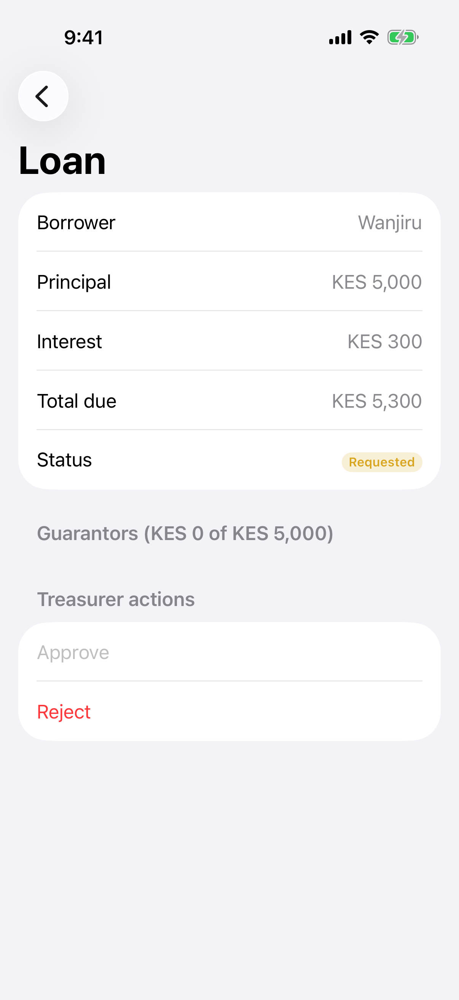
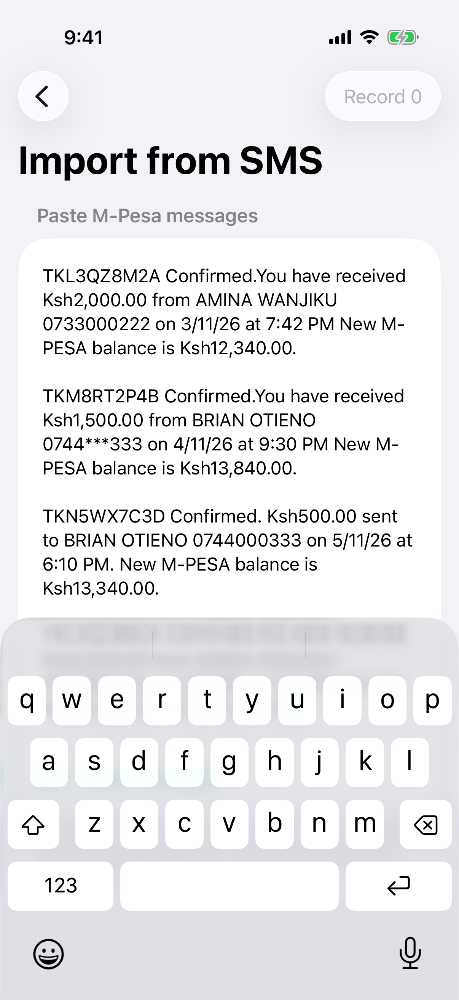
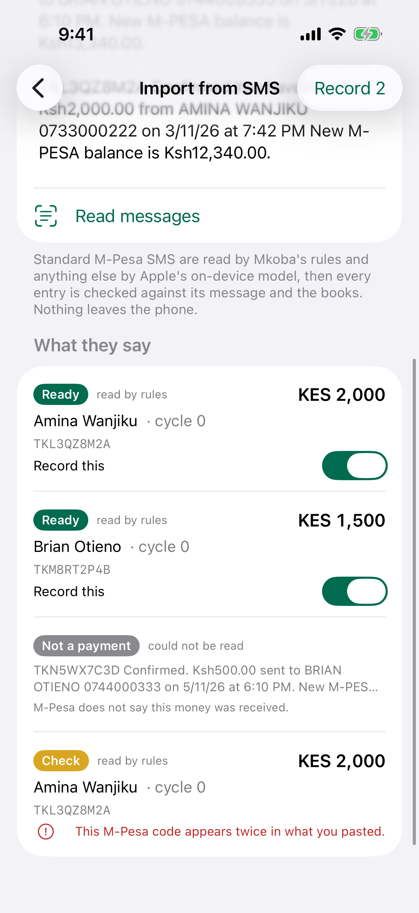

# Mkoba

[](https://github.com/tmjoris/mkoba/actions/workflows/ci.yml)

Offline-first chama (group savings) app for iOS, with M-Pesa contributions and SACCO-style lending.

A chama is a Kenyan savings group: members contribute on a schedule, the pot funds loans
guaranteed by other members, and the treasurer keeps the books. Mkoba replaces the exercise
book. It is built the way a bank would build it: every shilling is an integer, every change
is an immutable event, and the phone works in a village with no signal.

```
Sources/MkobaCore     Pure Swift 6. Money, event-sourced ledger, sync, Daraja types. Builds on Linux.
Server/               Vapor API: sync endpoint, M-Pesa STK push, callback, reconciliation.
iOS/                  SwiftUI app (MVVM), Core Data event store, Swift Charts, XCTest + XCUITest.
Assist/               SMS import with a language model (Foundation Models API), plus its evaluation.
```

## Screenshots

Captured by the `Screenshots` workflow on an iPhone 17 Pro simulator from the XCUITest walkthrough.

<p>




</p>
<p>




</p>

## Importing M-Pesa messages

Most contributions reach the treasurer as an M-Pesa SMS, and today each one is typed into
the books by hand. Mkoba lets the treasurer paste the messages instead. Each becomes a
proposed contribution that has already been checked, and nothing is recorded until she taps
Record.

Wanjiru, the treasurer of Umoja Chama, pastes four messages from her phone: Amina's
KES 2,000, Brian's KES 1,500 (his number partly hidden, as newer messages show it),
KES 500 she sent Brian herself, and Amina's message again by mistake.

<table>
<tr>
<td></td>
<td></td>
</tr>
<tr>
<td>1. She pastes the messages as they are.</td>
<td>2. Amina's and Brian's payments are <b>Ready</b>, matched to the right member and cycle.
The KES 500 she sent is <b>Not a payment</b>, because M-Pesa's message does not say it was received.
Amina's second copy is held for a <b>Check</b>: that code is already in the paste.
She taps <b>Record 2</b>.</td>
</tr>
</table>

Standard SMS like these are read by plain rules. Messages the rules cannot read (Swahili
SMS, text that wrapped or lost its spaces when copied, a payment forwarded with "hii ni ya
Mary", a member's own "nimetuma 2k") go to Apple's on-device model when Apple Intelligence
is on, through the Foundation Models API. The model only copies text out of the message.
Plain Swift turns that text into an amount, a member and a cycle, and checks every entry
against the message and the books: the code, amount, name and phone must be in the
message, the amount must not be the balance, the money must have been received, the code
must not already be recorded, and exactly one member must match. Nothing leaves the phone.

**How well it reads.** I tested this on 52 labelled messages (synthetic, written to look
like real ones) with open models the size of Apple's on-device model, on GitHub Actions:

| Reader | Correct | Wrong (recorded with one tap) | Sent to the treasurer | Dropped |
|---|---|---|---|---|
| Rules only | 41 | 0 | 1 | 10 |
| A 3B model trusted as is | 33 | 10 | 9 | 0 |
| Rules, then the 3B model, then the checks (what the app does) | **49** | **0** | 3 | 0 |

A model trusted as is would have put 10 wrong entries in the books: 4 payments the
treasurer *sent* read as money received, 3 members' notes taken as proof of payment, 2
guesses between members who share a surname, and 1 payment already in the books. The checks, not a better prompt, brought that to
zero. The first version of the checks still let 1 to 3 through per model, and I changed the
design twice because of what the results showed. The full write-up, with every run, is in
[Assist/Evals](Assist/Evals/README.md). The screenshots above come from a CI simulator,
where Apple's model reports itself available but its calls fail. That is why the KES 500
message is labelled "could not be read": the rules and the checks still handled it.

## What is interesting about it

**Money is never a `Double`.** `Money` is `Int64` minor units plus a currency. Adding,
multiplying by a rate in basis points, and splitting into instalments are all exact, and a
split of KES 100 three ways gives 33.34, 33.33, 33.33 that sums back to 100.00.

**The ledger is an append-only event log.** Nothing is edited or deleted. State is a fold
over events, so the app can answer "what did the books say on 3 March" and an auditor can
see every refused entry with the reason it was refused.

**Two treasurers can both be offline and still agree.** Each event carries a Lamport
timestamp and a device id, giving a total order every device agrees on. Replay is
deterministic: the test suite shuffles events 50 ways, injects duplicates, and asserts the
identical state each time. Validation runs at replay time, not at write time, because an
offline phone cannot know the latest state. A payout recorded on a phone that saw KES 2,000
in the pot is accepted after sync if the merged pot covers it, and rejected otherwise, on
every device the same way.

**Sync is a vector-clock diff.** A phone sends "here is what I have seen and here is what is
new"; the server merges and answers with only what the phone lacks. No timestamps compared
across devices, no last-write-wins.

**M-Pesa payments cannot double-charge.** A contribution goes `requested -> promptSent ->
completed | failed`, and if Daraja's callback never arrives it becomes `unknown`, never
`failed`. No second STK prompt can be sent until a transaction status query says the first
one is dead. Duplicate callbacks (Daraja retries them) are no-ops. Only a completed payment
writes to the ledger, and it writes exactly once. The server test suite drives all of these
through a Daraja simulator where the phone number's last two digits choose the outcome
(`..11` cancel, `..22` insufficient funds, `..33` lost callback then paid, `..44` lost
callback and never seen).

**The receipt is the authority.** Cash contributions need an official's signature. An M-Pesa
receipt is its own proof, so a member may record their own paid contribution.

## Running the core and server on Linux or macOS

```sh
swift test                         # money, ledger, schedule, Daraja, state machine, SMS import checks
cd Server && swift test            # end-to-end payment flows against the simulator
cd Assist && swift test            # eval set and scoring
cd Server && swift run             # http://127.0.0.1:8080, data in Server/data/store.json
```

Point it at the real Daraja sandbox with:

```sh
export DARAJA_CONSUMER_KEY=... DARAJA_CONSUMER_SECRET=... DARAJA_PASSKEY=...
export PUBLIC_BASE_URL=https://<your-tunnel>   # Daraja must be able to POST the callback
swift run
```

To read the test messages with a model yourself (any Ollama model):

```sh
cd Assist
swift run mkoba-eval run --reader regex --out results/regex.jsonl
swift run mkoba-eval run --reader ollama --model qwen2.5:3b --out results/qwen2.5-3b.jsonl
swift run mkoba-eval summarize results/*.jsonl
```

## Running the iOS app

Requires an Xcode with Swift 6.3 or later on macOS (CI uses Xcode 26.6 on `macos-26`). The app runs on iOS 17; the on-device model is used on iOS 26 with Apple Intelligence on.

```sh
brew install xcodegen
cd iOS && xcodegen generate && open Mkoba.xcodeproj
```

Xcode asks you to trust AnyLanguageModel's macros the first time; CI passes `-skipMacroValidation`.

The `Mkoba` scheme runs the unit tests (Core Data store, session) and the UI tests, which
create a group, add a member and record a contribution entirely offline against an in-memory
store. CI does the same on a macOS runner.

## Architecture

```
 SwiftUI views ──▶ GroupSession (@Observable)  ──▶ EventLog + LedgerState (MkobaCore)
                        │  record()  │ sync()
                        ▼            ▼
              CoreDataEventStore   APIClient ──HTTPS──▶ Vapor /v1/groups/:id/sync
              (events as JSON,                              │
               unique by id)                                ▼
                                                      Store (actor) ──▶ EventLog.serve()
 ContributeView ──▶ ContributeViewModel ──▶ /v1/payments ──▶ PaymentService
                                                               │ STK push
                                                               ▼
                                                   DarajaGateway (live | simulator)
                                                               │ callback / status query
                                                               ▼
                                                   PendingPayment state machine ──▶ ledger (once)
```

- **Pattern:** MVVM. Views are dumb; `GroupSession` and `ContributeViewModel` hold state.
- **Persistence:** Core Data with a uniqueness constraint on event id, file protection
  `completeUntilFirstUserAuthentication`, `NSMergeByPropertyObjectTrumpMergePolicy` so a
  duplicate insert is a no-op.
- **Keychain:** the device identity that stamps events lives in the Keychain,
  `AfterFirstUnlockThisDeviceOnly`, never in iCloud.
- **Networking:** `URLSession` with App Transport Security at its default (no exceptions).
- **Concurrency:** Swift 6 strict concurrency; the server store is an actor.
- **Tests:** XCTest for the core and server, XCUITest for the three main flows.

## Status

- [x] Core ledger, money, sync, Daraja types, payment state machine (Linux CI)
- [x] Vapor server with simulator and sandbox support
- [x] iOS app: groups, dashboard, members, contribute, cash, loans; unit and UI tests green on a macOS runner
- [x] Screenshots, captured in CI
- [x] SMS import: rules, then Apple's on-device model, then checks; evaluated with four open models on Actions
- [ ] Try the import with Apple's on-device model on a real iPhone
- [ ] TestFlight
